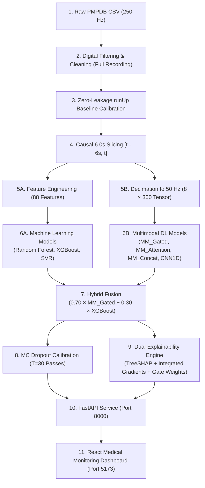
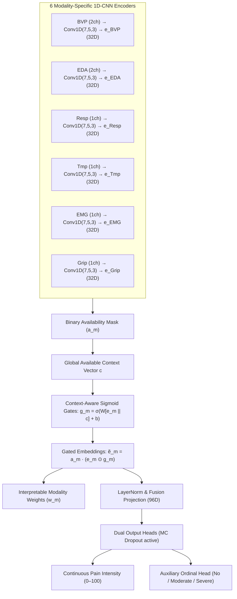

# Complete System Guide — Explainable Multimodal AI for Continuous Pain-Intensity Estimation

This guide explains the entire system from first principles: the biomedical problem, the physical sensor inputs, every engineered feature, every machine learning and deep learning model architecture, how missing modalities are handled, the mathematical and practical inputs/outputs, and step-by-step commands to run the entire project.

---

## Table of Contents
1. [Core Working Concept & Real-World Goal](#1-core-working-concept--real-world-goal)
2. [Exact Inputs and Outputs of the System](#2-exact-inputs-and-outputs-of-the-system)
3. [End-to-End System Workflow](#3-end-to-end-system-workflow)
4. [The 6 Sensor Modalities & All 88 Engineered Features](#4-the-6-sensor-modalities--all-88-engineered-features)
5. [The 10 Models: Architecture, Working, & Equations](#5-the-10-models-architecture-working--equations)
6. [Uncertainty Quantification (MC Dropout)](#6-uncertainty-quantification-mc-dropout)
7. [Explainable AI (SHAP, Integrated Gradients, & Neural Gates)](#7-explainable-ai-shap-integrated-gradients--neural-gates)
8. [Missing-Modality Handling (Zero Fabrication)](#8-missing-modality-handling-zero-fabrication)
9. [Step-by-Step Setup & Running Commands](#9-step-by-step-setup--running-commands)
10. [Key Scientific Findings & Clinical Ethics](#10-key-scientific-findings--clinical-ethics)

---

## 1. Core Working Concept & Real-World Goal

### The Problem
Pain is a subjective experience. In clinical and physiotherapy settings, the standard metric is the **Numerical Rating Scale (NRS)** from 0 to 10 (or 0–100), where a patient verbally rates their pain. However:
- Self-reporting is **intermittent** (a patient cannot speak while performing a difficult exercise or when fatigued).
- Self-reporting is **impossible** for non-verbal, sedated, or cognitively impaired patients.
- Clinicians need an **objective, continuous monitor** that tracks whether physical therapy exercises are causing acute pain exacerbation in real time.

### The Solution Built Here
This system listens to continuous physiological and biomechanical sensor streams (heart rate, skin conductance, breathing, temperature, muscle activity, grip force) collected during physical exercises. It uses a **hybrid ensemble of multimodal deep learning (1D CNN encoders with gated fusion) and machine learning (XGBoost/RandomForest)** to output a **continuous estimated pain intensity (0–100)** every second, accompanied by a **95% prediction interval (uncertainty)** and **transparent explanations (which sensor caused the pain spike)**.

### Dataset Grounding (PMPDB)
The entire pipeline is trained, validated, and evaluated on your local **PainMonit Physiotherapy Database (PMPDB)**:
- **49 unique human participants** (`P01` to `P49`) performing standardized physiotherapy exercises.
- **90 main sessions** (3.30 hours total) + **90 pre-session calibration recordings** (`<ID>_runUp.csv`, 0.88 hours total).
- **Uniform 250.0 Hz sampling rate** across 8 hardware channels.
- **0.00% missing values** in physiological recordings.
- **Explicit Sensor Grounding**: PMPDB records **BVP, EDA, Respiration, Skin Temperature, Surface EMG, and Grip Force**. It contains **neither ECG nor EEG**. Pulse rate and pulse rate variability (PRV) are extracted from photoplethysmography (BVP/PPG). No brainwaves or ECG leads are fabricated.

---

## 2. Exact Inputs and Outputs of the System

### System Inputs
The input to the system is a **causal 6.0-second time window `[t − 6.0s, t]`** ending at current timestamp `t`.

```text
Input Window: 6.0 seconds @ 250.0 Hz = 1,500 samples per channel across 8 synchronized channels
Shape: (8, 1500) raw matrix
```

1. **`Bvp`** (Empatica E4 wristband optical PPG sensor)
2. **`Bvp_RB`** (RespiBAN optical PPG sensor on finger/chest)
3. **`Eda_E4`** (Empatica E4 wrist electrodermal activity / skin conductance in µS)
4. **`Eda_RB`** (RespiBAN palmar electrodermal activity in µS)
5. **`Resp`** (RespiBAN inductive chest belt measuring thoracic expansion)
6. **`Tmp`** (Empatica E4 peripheral skin temperature in °C)
7. **`Emg`** (RespiBAN surface electromyography measuring muscle contraction voltage)
8. **`Grip`** (RespiBAN hand dynamometer measuring isometric grip force)
9. **Calibration Baseline**: Mean and standard deviation from the participant's own pre-exercise `<ID>_runUp.csv` baseline (zero train/test leakage).
10. **Binary Availability Mask**: A 6-element binary vector $[a_{\text{BVP}}, a_{\text{EDA}}, a_{\text{Resp}}, a_{\text{Tmp}}, a_{\text{EMG}}, a_{\text{Grip}}] \in \{0, 1\}^6$ indicating which sensors are currently plugged in and streaming valid non-flatline data.

### System Outputs
For every inference window, the system produces a structured clinical response:

```json
{
  "predicted_pain_0_100": 68.4,
  "predicted_pain_nrs_10": 6.84,
  "severity_category": "High Pain",
  "confidence_interval_95": [46.1, 90.7],
  "uncertainty_std": 11.38,
  "uncertainty_level": "Moderate",
  "component_predictions": {
    "mm_gated": 67.2,
    "xgboost": 71.2,
    "random_forest": 69.5
  },
  "ordinal_class_probabilities": {
    "no_low_pain": 0.042,
    "moderate_pain": 0.285,
    "severe_pain": 0.673
  },
  "sensor_status": {
    "BVP": {"available": true},
    "EDA": {"available": true},
    "Resp": {"available": true},
    "Tmp": {"available": true},
    "EMG": {"available": true},
    "Grip": {"available": true}
  },
  "explainability": {
    "primary_modality": "EMG",
    "summary": "Estimated pain is 68.4/100 (High Pain) with 95% interval [46.1, 90.7]. Primary physiological driver: EMG muscle guarding.",
    "top_features": [
      {"feature": "EMG_rms_ratio", "modality": "EMG", "shap_value": +7.82},
      {"feature": "EDA_RB_scl_rel_runup", "modality": "EDA", "shap_value": +4.15}
    ],
    "neural_gate_weights_pct": {
      "EMG": 24.8, "EDA": 21.2, "BVP": 18.1, "Grip": 16.5, "Resp": 12.0, "Tmp": 7.4
    }
  }
}
```

---

## 3. End-to-End System Workflow



---

## 4. The 6 Sensor Modalities & All 88 Engineered Features

All digital filtering is applied to the full recording before window slicing to completely eliminate filter edge transients.

### Modality 1: Blood Volume Pulse (BVP / PPG) — 22 Features
Measures pulsatile blood flow changes in microvascular tissue using optical photoplethysmography from the Empatica E4 wristband (`Bvp`) and RespiBAN sensor (`Bvp_RB`).
- **Cleaning Filter**: 4th-order zero-phase Butterworth bandpass filter (`0.5 Hz – 8.0 Hz`) to remove DC baseline wander and high-frequency motion noise while preserving systolic peaks.
- **Extracted Features (computed separately for `E4` and `RB`)**:
  1. `BVP_<src>_std`: Amplitude standard deviation across the 6-second window.
  2. `BVP_<src>_rms`: Root-mean-square amplitude of pulsatile waves.
  3. `BVP_<src>_ptp`: Peak-to-peak amplitude difference (systolic crest to diastolic trough).
  4. `BVP_<src>_pr_bpm`: **Pulse Rate in beats per minute**, calculated from detected systolic peak inter-beat intervals (IBI): $\text{PR} = \frac{60}{\text{mean}(\text{IBI})}$.
  5. `BVP_<src>_prv_sdnn_ms`: **Pulse Rate Variability (PRV) SDNN**, the standard deviation of valid IBIs in milliseconds. Reflects sympathetic/parasympathetic autonomic tone.
  6. `BVP_<src>_prv_rmssd_ms`: **PRV RMSSD**, the root mean square of successive IBI differences. Key clinical indicator of parasympathetic vagal withdrawal during acute pain.
  7. `BVP_<src>_prv_pnn50`: Percentage of successive IBI differences exceeding 50 ms.
  8. `BVP_<src>_peak_amp_norm`: Mean systolic pulse height normalized by the participant's pre-session runUp baseline standard deviation.
  9. `BVP_<src>_cardiac_power_ratio`: Proportion of total spectral power residing in the cardiac band (`0.7 Hz – 3.5 Hz`), computed via Welch's power spectral density (PSD).
  10. `BVP_<src>_rms_ratio`: Ratio of current window RMS amplitude to the participant's pre-session baseline RMS (detects peripheral vasoconstriction).
  11. `delta_BVP_E4_pr_bpm` & `delta_BVP_RB_rms_ratio`: Temporal delta compared against the preceding window `[t − 12s, t − 6s]`.

### Modality 2: Electrodermal Activity (EDA) — 27 Features
Measures eccrine sweat gland activation controlled exclusively by the sympathetic nervous system (fight-or-flight stress response) via Empatica E4 wrist electrodes (`Eda_E4`) and RespiBAN palmar electrodes (`Eda_RB`).
- **Cleaning Filter**: 4th-order Butterworth lowpass filter (`5.0 Hz`).
- **Tonic / Phasic Decomposition**:
  - **Tonic Component (SCL - Skin Conductance Level)**: Separated via a 2nd-order lowpass filter (`0.05 Hz`). Reflects slow, underlying autonomic arousal.
  - **Phasic Component (SCR - Skin Conductance Response)**: Computed as $\text{Phasic} = \text{Cleaned} - \text{Tonic}$. Captures rapid, stimulus-induced transient sweat gland bursts.
- **Extracted Features (computed for `E4` and `RB`)**:
  1. `EDA_<src>_scl_mean`: Mean tonic skin conductance level.
  2. `EDA_<src>_scl_std`: Standard deviation of the tonic level.
  3. `EDA_<src>_scl_slope`: Linear regression slope of the tonic level across the 6 seconds ($\mu\text{S/s}$).
  4. `EDA_<src>_scl_delta`: Net tonic change: $SCL(t) - SCL(t - 6\text{s})$.
  5. `EDA_<src>_scl_rel_runup`: Subject-calibrated tonic shift: $\frac{\text{mean}(SCL) - \mu_{\text{runUp}}}{\sigma_{\text{runUp}}}$.
  6. `EDA_<src>_phasic_std`: Energy/variance of the phasic sweat response.
  7. `EDA_<src>_phasic_auc`: Positive area under the curve of the phasic component (accumulated sympathetic discharge).
  8. `EDA_<src>_scr_count`: Number of distinct Skin Conductance Response peaks detected within the 6-second window (prominence $\ge 0.015\,\mu\text{S}$, distance $\ge 0.8\text{ s}$).
  9. `EDA_<src>_scr_amp_mean`: Mean amplitude of detected SCR peaks.
  10. `EDA_<src>_scr_amp_max`: Maximum peak height of the strongest SCR burst.
  11. `EDA_<src>_deriv_std`: Standard deviation of the first derivative of the cleaned signal.
  12. `EDA_<src>_deriv_max`: Maximum rise velocity ($\mu\text{S/s}$).
  13. `delta_EDA_E4_scl_rel_runup`, `delta_EDA_RB_scl_rel_runup`, `delta_EDA_RB_phasic_auc`: Temporal escalation deltas.

### Modality 3: Respiration (Resp) — 9 Features
Measures thoracic expansion and breathing dynamics using the RespiBAN inductive chest belt (`Resp`). Acute pain induces rapid, shallow breathing or breath-holding.
- **Cleaning Filter**: 3rd-order Butterworth bandpass filter (`0.05 Hz – 1.0 Hz`, corresponding to 3 to 60 breaths per minute).
- **Extracted Features**:
  1. `Resp_std`: Overall breathing movement variability.
  2. `Resp_rms`: Root-mean-square breathing amplitude.
  3. `Resp_ptp`: Peak-to-peak tidal volume proxy.
  4. `Resp_rate_bpm`: **Respiratory rate in breaths per minute**, calculated from detected inhalation peaks, with a Welch PSD dominant frequency fallback for short windows with fewer than 2 breath cycles.
  5. `Resp_ibi_std`: Inter-breath interval irregularity.
  6. `Resp_slope`: Linear trend of the thoracic belt signal.
  7. `Resp_rms_ratio`: Ratio of current breathing amplitude to baseline calibration amplitude.
  8. `Resp_mean_rel_runup`: Baseline respiratory offset shift.
  9. `delta_Resp_rms_ratio`: Change in breathing intensity from previous window.

### Modality 4: Skin Temperature (Tmp) — 8 Features
Measures peripheral cutaneous temperature in degrees Celsius from the Empatica E4 wrist sensor (`Tmp`). Acute sympathetic activation causes peripheral vasoconstriction, leading to micro-drops in peripheral temperature.
- **Cleaning Filter**: 3rd-order Butterworth lowpass filter (`0.5 Hz`).
- **Extracted Features**:
  1. `Tmp_mean`: Mean temperature across the window (°C).
  2. `Tmp_std`: Temperature stability.
  3. `Tmp_ptp`: Maximum temperature drift.
  4. `Tmp_slope`: Rate of temperature change ($\Delta^\circ\text{C/second}$).
  5. `Tmp_delta`: Net temperature difference over 6 seconds.
  6. `Tmp_rel_runup_c`: Absolute temperature shift relative to pre-session baseline (°C).
  7. `Tmp_rel_runup_z`: Z-score normalized temperature shift.
  8. `delta_Tmp_rel_runup_c`: Temporal delta against preceding window.

### Modality 5: Surface Electromyography (EMG) — 10 Features
Measures electrical potentials generated by muscle contraction using RespiBAN bipolar surface electrodes (`Emg`). During painful physiotherapy exercises, patients involuntarily contract nearby muscles (protective muscle guarding).
- **Cleaning Filter**: 50 Hz IIR notch filter ($Q=30$) to remove European powerline hum + 4th-order Butterworth bandpass filter (`20.0 Hz – 120.0 Hz`, respecting the 125 Hz Nyquist frequency).
- **Extracted Features**:
  1. `EMG_rms`: Root-mean-square amplitude, proportional to muscle contraction force.
  2. `EMG_mav`: Mean Absolute Value ($\text{MAV} = \frac{1}{N}\sum |x_i|$).
  3. `EMG_peak`: Maximum spike amplitude.
  4. `EMG_wl`: **Waveform Length** ($\sum |x_i - x_{i-1}|$), capturing complexity and high-frequency firing.
  5. `EMG_zcr`: Zero Crossing Rate (frequency of polarity reversals).
  6. `EMG_iemg`: Integrated EMG (total muscle electrical effort).
  7. `EMG_mean_freq`: Mean spectral frequency from Welch PSD.
  8. `EMG_median_freq`: Median spectral frequency (clinical indicator of muscle fatigue).
  9. `EMG_rms_ratio`: Current contraction RMS normalized by pre-session resting RMS. **This is the single highest-correlated feature with pain ($r = 0.369, \rho = 0.429$).**
  10. `delta_EMG_rms_ratio`: Rapid surge in muscle guarding relative to preceding window.

### Modality 6: Grip Force (Grip) — 10 Features
Measures isometric handgrip force using the RespiBAN hand dynamometer (`Grip`). Patients involuntarily clench or reflexively drop their grip when pain escalates during physical maneuvers.
- **Cleaning Filter**: 4th-order lowpass filter (`10.0 Hz`).
- **Extracted Features**:
  1. `Grip_mean`: Average exerted force.
  2. `Grip_std`: Force tremor and fluctuation.
  3. `Grip_min` & `Grip_max`: Extremes of grip exertion.
  4. `Grip_ptp`: Dynamic force range.
  5. `Grip_slope`: Rate of force build-up or release.
  6. `Grip_delta`: Net force difference over 6 seconds.
  7. `Grip_rel_runup_z`: Exertion normalized against baseline calibration.
  8. `Grip_peak_rel_runup_z`: Peak exertion burst normalized against baseline.
  9. `delta_Grip_rel_runup_z`: Change in grip clenching relative to prior window.

### Context Features — 2 Features
- `Temporal_elapsed_sec`: Elapsed time into the exercise session.
- `Temporal_progress_ratio`: Percentage completion of the recording (`0.0` to `1.0`).

**Total = 22 + 27 + 9 + 8 + 10 + 10 + 2 = 88 features**, saved in `features.parquet` and `features.csv`.

---

## 5. The 10 Models: Architecture, Working, & Equations

All models predict continuous pain on the common **0–100 scale** (mapped linearly from PMPDB's 1–10 NRS self-reports via $\text{Pain} = \text{NRS} \times 10$). All were evaluated on identical **5-Fold GroupKFold** participant splits (no participant appears in both training and test sets).

```text
               Participant-Independent 5-Fold GroupKFold Benchmark
Model                   Family              MAE ↓    RMSE ↓   Pearson r ↑   Lin's CCC ↑   R² ↑
MM_Gated                Multimodal DL       17.47    21.52    0.491         0.424         0.234
Hybrid_MM_Gated_XGB     Hybrid Ensemble     17.57    21.54    0.486         0.400         0.232
MM_Attention            Multimodal DL       17.74    21.56    0.485         0.406         0.231
MM_Concat               Multimodal DL       18.22    22.23    0.436         0.353         0.182
CNN1D                   Deep Learning       18.59    22.75    0.396         0.320         0.144
CNN_BiGRU               Deep Learning       18.68    22.82    0.393         0.321         0.138
RandomForest            Baseline ML         18.72    22.73    0.388         0.289         0.145
XGBoost                 Baseline ML         19.23    23.71    0.352         0.297         0.070
SVR                     Baseline ML         19.27    23.40    0.354         0.288         0.094
TCN                     Deep Learning       19.30    23.53    0.322         0.244         0.084
```

---

### Model 1: `MM_Gated` (Gated Multimodal Fusion Network) — Best Model
The premier deep learning architecture in this project. Specifically designed for multimodal physiological data where different sensor channels have vastly different noise characteristics and can drop out unexpectedly.



1. **Modality Encoders**: 6 separate 1D convolutional neural networks. Each encoder takes only its assigned channels (e.g., `BVP` takes `[Bvp, Bvp_RB]`):
   $$\text{Conv1D}(24, k=7) \rightarrow \text{BatchNorm} \rightarrow \text{GELU} \rightarrow \text{MaxPool}(2) \rightarrow \text{Dropout}(0.25) \rightarrow \text{Conv1D}(32, k=5) \rightarrow \text{MaxPool}(2) \rightarrow \text{Conv1D}(32, k=3)$$
   Both average pooling and max pooling over time are concatenated to form a rich **32-dimensional embedding** $\mathbf{e}_m \in \mathbb{R}^{32}$ per modality.
2. **Context-Aware Sigmoid Gating**: An available-context vector $\mathbf{c} = \frac{\sum_m a_m \mathbf{e}_m}{\max(1, \sum_m a_m)}$ is computed. Each modality's gate $\mathbf{g}_m \in (0, 1)^{32}$ observes both its own embedding and the global context:
   $$\mathbf{g}_m = \sigma\big(W_m [\mathbf{e}_m \,\|\, \mathbf{c}] + b_m\big), \qquad \tilde{\mathbf{e}}_m = a_m \cdot (\mathbf{e}_m \odot \mathbf{g}_m)$$
3. **Loss Function**: Trained with **Huber Loss** ($\beta = 10.0$) on regression combined with auxiliary Cross-Entropy on ordinal classification:
   $$\mathcal{L} = \text{HuberLoss}(\hat{y}, y; \beta=10.0) + 1.5 \times \text{CrossEntropyLoss}(\hat{p}_{\text{cls}}, y_{\text{cls}})$$
   *Why Huber Loss?* Squared error ($L_2$) over-penalizes subjective human labeling discrepancies, while absolute error ($L_1$) has non-smooth gradients near zero. Huber loss smoothly bridges both.

---

### Model 2: `Hybrid_MM_Gated_XGB` (Hybrid Ensemble) — Production Default
Combines the representation-learning strengths of deep neural networks with the non-linear decision boundary strengths of gradient-boosted trees on engineered physiological features:
$$\hat{y}_{\text{hybrid}} = 0.70 \times \hat{y}_{\text{MM\_Gated}} + 0.30 \times \hat{y}_{\text{XGBoost}}$$
- When all sensors are present, it balances deep waveform patterns with clinical feature rules.
- If a sensor disconnects, it routes to `xgb_missing_resilient` (trained with simulated NaN dropout) and masks the neural input, automatically widening uncertainty bounds proportionally to model disagreement:
  $$\sigma_{\text{hybrid}} = \sqrt{\sigma_{\text{deep}}^2 + (0.35 \times |\hat{y}_{\text{deep}} - \hat{y}_{\text{xgb}}|)^2}$$

---

### Model 3: `MM_Attention` (Attention-Based Multimodal Fusion)
Replaces the sigmoid gates with a **4-head Multihead Self-Attention layer** across the 6 modality tokens:
$$\text{Tokens} = [\mathbf{e}_{\text{BVP}} + \mathbf{p}_1, \dots, \mathbf{e}_{\text{Grip}} + \mathbf{p}_6] \in \mathbb{R}^{6 \times 32}$$
- Uses a **Key Padding Mask** ($a_m = 0$) so missing modalities are excluded from attention softmax calculations.
- Yields the highest ordinal classification macro F1 (`0.371`) and competitive regression (`MAE = 17.74`).

---

### Model 4: `MM_Concat` (Concatenation Baseline)
A classic multimodal fusion baseline: runs the 6 modality encoders and simply concatenates all embeddings into a flat $6 \times 32 = 192$-dimensional vector $\mathbf{z} = [\tilde{\mathbf{e}}_{\text{BVP}} \,\|\, \dots \,\|\, \tilde{\mathbf{e}}_{\text{Grip}}]$, feeding into a 2-layer MLP head (`MAE = 18.22`).

---

### Model 5: `CNN1D` (Multi-Scale 1D CNN Baseline)
A single-stream neural network that takes all 8 channels together without modality separation:
- Two parallel input branches: small receptive field ($k=3$, high temporal resolution) and large receptive field ($k=9$, slow wave trends).
- Concatenates branches into a 3-layer deep convolutional backbone with batch normalization and max-pooling (`MAE = 18.59`).

---

### Model 6: `CNN_BiGRU` (Temporal Recurrent Architecture)
Combines multi-layer 1D convolutions with a **Bidirectional Gated Recurrent Unit (BiGRU)**:
- Convolutions compress the 300-step input sequence down to 50 temporal feature frames.
- A 2-directional GRU captures sequential progression forward and backward in time.
- Temporal attention pooling aggregates hidden states into a single pain estimate (`MAE = 18.68`).

---

### Model 7: `TCN` (Temporal Convolutional Network)
A Dilated Causal Convolutional Network composed of stacked residual blocks with exponentially increasing dilation factors ($d \in \{1, 2, 4, 8\}$):
- Receptive field expands exponentially without losing temporal resolution or suffering from vanishing gradients.
- Achieves `MAE = 19.30`.

---

### Model 8: `RandomForest` Regressor (Ensemble of Decision Trees)
An ensemble of 250 randomized decision trees operating on the 88 engineered features:
- Sub-samples features via $\sqrt{N}$ at each split, trained with `min_samples_leaf=4`.
- **Top baseline ML performer** (`MAE = 18.72`, `r = 0.388` in 5-Fold GroupKFold; `MAE = 18.90` in 49-Fold LOSO).
- Provides tree variance as an initial measure of predictive disagreement.

---

### Model 9: `XGBoost` Regressor & `xgb_missing_resilient`
Gradient boosted trees minimizing squared error with $L_1$ and $L_2$ regularization:
- Evaluated on 5-Fold GroupKFold (`MAE = 19.23`, `r = 0.352`) and 49-Fold LOSO (`MAE = 19.25`, `r = 0.365`, `CCC = 0.307`).
- The project also trains a specialized production variant: **`xgb_missing_resilient`**, trained with simulated modality-dropout NaN augmentation so tree nodes learn optimal default split directions when sensor values are missing (preventing imputation distortion).

---

### Model 10: `SVR` (Support Vector Regression)
A kernel machine using the Radial Basis Function (RBF) kernel:
$$K(\mathbf{x}_i, \mathbf{x}_j) = \exp(-\gamma \|\mathbf{x}_i - \mathbf{x}_j\|^2)$$
- Features are scaled via `RobustScaler` (median-centered, IQR-scaled) to handle physiological outliers.
- Fitted with $C = 25.0, \epsilon = 3.0$ (`MAE = 19.27`, `r = 0.354`).

---

## 6. Uncertainty Quantification (MC Dropout)

Standard neural networks output an overconfident single number without knowing whether they are guessing. In clinical monitoring, **knowing when the model is uncertain is critical**.

### Monte Carlo (MC) Dropout Implementation
1. At inference time, `BatchNorm` layers are locked into `eval()` mode to preserve running statistics, but **Dropout layers ($p = 0.30$) are kept active**.
2. The network runs **$T = 30$ stochastic forward passes** through `predict_mc_dropout`:
   $$\hat{\mu} = \frac{1}{T} \sum_{t=1}^T \hat{y}^{(t)}, \qquad \hat{\sigma}_{\text{raw}} = \sqrt{\frac{1}{T}\sum_{t=1}^T \big(\hat{y}^{(t)} - \hat{\mu}\big)^2}$$
3. **Empirical Residual Calibration**: Because raw dropout variance tends to underestimate the true ground-truth error distribution, we calibrate the standard deviation against out-of-fold validation residuals using scaling factor $s$:
   $$\sigma = s \cdot \hat{\sigma}_{\text{raw}}$$
4. **95% Prediction Interval**:
   $$[\text{Lower}, \text{Upper}] = \big[\max(0, \hat{\mu} - 1.96\sigma), \; \min(100, \hat{\mu} + 1.96\sigma)\big]$$
   Evaluated strictly out-of-fold, this achieves **95.0% empirical coverage (PICP = 95.0%)** on `MM_Gated`.

---

## 7. Explainable AI (SHAP, Integrated Gradients, & Neural Gates)

A doctor or patient cannot trust a black-box model. The system integrates **three complementary explainability mechanisms**:

```text
               Explainability Triangulation Across the 6 PMPDB Modalities
Modality       TreeSHAP (Features)       Integrated Gradients (Waveform)     Neural Gating Weights
EMG            25.7% (Muscle guarding)   12.5%                               16.8%
EDA            22.1% (Sympathetic sweat) 15.1%                               15.8%
BVP            18.9% (Pulse / PRV)       29.1% (Cardiac pulsatility)         16.3%
Grip           16.5% (Reflexive force)    9.1%                               16.9%
Tmp             7.3% (Vasoconstriction)   4.4%                               18.3%
Resp            6.8% (Breath changes)    29.8% (Tidal amplitude)             16.0%
Temporal        2.8% (Time context)       —                                   —
```

### 1. TreeSHAP (Feature-Level Attributions)
Uses cooperative game theory (Shapley values) via `shap.TreeExplainer` on the trained XGBoost model to decompose the exact contribution of each of the 88 features:
$$\hat{y} = \phi_0 + \sum_{i=1}^{88} \phi_i$$
- $\phi_i > 0$: Feature pushed predicted pain higher (e.g., elevated `EMG_rms_ratio`).
- $\phi_i < 0$: Feature pulled predicted pain lower (e.g., steady baseline `Resp_rate_bpm`).

### 2. Integrated Gradients (Deep Waveform & Temporal Attribution)
For the deep neural network (`MM_Gated`), Integrated Gradients computes path integrals of gradients along a straight line from a neutral baseline (zero signal) to the input window $\mathbf{x}$:
$$\text{IG}_i(\mathbf{x}) = (x_i - x_i') \times \int_{0}^1 \frac{\partial F(x' + \alpha(x - x'))}{\partial x_i} d\alpha$$
- Evaluated across 24 Riemann steps.
- Produces **Temporal Salience**: divides the 6.0-second window into 12 half-second bins (`-6.0s` to `0.0s`), revealing exactly which sub-second surge in muscle or breath activity triggered the pain estimate.

### 3. Neural Gate Weights
The sigmoid gating network inside `MM_Gated` outputs normalized percentage weights ($w_m$) indicating how much attention the neural network granted to each of the 6 modalities during that specific window.

---

## 8. Missing-Modality Handling (Zero Fabrication)

In live clinical monitoring, an electrode can peel off, or a wristband might lose skin contact. **Never fabricate missing signals with synthetic or average data.**

### How the System Responds to Dropped Sensors
1. **Real-Time Detection**: The API inspects incoming samples. If a channel has $>50\%$ NaNs, is absent, or has near-zero variance ($\text{std} < 10^{-7}$), it is marked as `OFFLINE`.
2. **Binary Masking in Deep Models**: The binary modality availability mask sets $a_m = 0$. The raw channels are zeroed, and the gating and attention layers exclude the missing modality completely.
3. **Native NaN Routing in XGBoost**: Missing features are left as `NaN`. The trained `xgb_missing_resilient` tree model routes NaNs to the branch that minimizes prediction variance.
4. **Automatic Uncertainty Expansion**: Missing sensors proportionally widen the reported uncertainty interval:
   $$\sigma_{\text{adjusted}} = \sigma \times \big(1.0 + 0.15 \times N_{\text{missing}}\big)$$
5. **Stress Test Validation**: The system was tested across 7 sensor-failure scenarios (e.g., completely dropping EDA, BVP, Grip, EMG, or entire RespiBAN unit). Performance degrades gracefully:
   - Full 6 modalities: $\text{MAE} = 17.45, \sigma = 22.25$
   - Missing EDA: $\text{MAE} = 17.74, \sigma = 22.19$
   - Missing Grip: $\text{MAE} = 18.12, \sigma = 22.98$
   - Missing EMG: $\text{MAE} = 20.10, \sigma = 24.24$
   - Wearable E4 only (`BVP + EDA + Tmp`): $\text{MAE} = 22.34, \sigma = 26.50$

---

## 9. Step-by-Step Setup & Running Commands

Follow these exact commands from your terminal to run, reproduce, or inspect the project.

### Step 1: Open PowerShell / Terminal in the Project Directory
```powershell
cd c:\Users\Amol\Downloads\PMCD\pain-intensity-estimation
```

### Step 2: Install Python Dependencies
```powershell
pip install -r backend/requirements.txt
```
*(Dependencies: `numpy`, `pandas`, `scipy`, `scikit-learn`, `xgboost`, `torch`, `shap`, `fastapi`, `uvicorn`, `pydantic`, `matplotlib`, `seaborn`, `pyarrow`, `joblib`, `httpx`)*

### Step 3: Run the Data Preprocessing Pipeline (Phase 1–3)
```powershell
# 1. Audit PMPDB dataset and generate reports/dataset_analysis_report.md
python -m backend.preprocessing.inspect_pmdb

# 2. Clean signals, extract 88 features & build 50 Hz DL tensors
python -m backend.preprocessing.signal_pipeline
```
*Outputs: `dataset/processed/features.parquet`, `dataset/processed/windows_dl.npz`, `dataset/metadata/dataset_summary.json`.*

### Step 4: Generate Exploratory Data Analysis Plots (Phase 4)
```powershell
python -m backend.evaluation.eda_plots
```
*Outputs: 7 figures saved to `reports/figures/` (multimodal waveforms, EDA decomposition, BVP peaks, correlations).*

### Step 5: Train All Baseline Machine Learning Models (Phase 5)
```powershell
python -m backend.training.train_baselines
```
*Outputs: Trains RandomForest, XGBoost, SVR with 5-Fold GroupKFold and 49-Fold LOSO, plus modality ablation. Saves `.joblib` checkpoints.*

### Step 6: Train All Deep Learning & Multimodal Fusion Models (Phase 6–7)
```powershell
python -m backend.training.train_deep
```
*Outputs: Trains CNN1D, CNN_BiGRU, TCN, MM_Concat, MM_Attention, and MM_Gated with MC Dropout and missing-modality stress testing. Saves `.pt` checkpoints.*

### Step 7: Run Explainable AI & Generate Final Evaluation Report (Phase 8–9)
```powershell
# Compute global SHAP & Integrated Gradients
python -m backend.explainability.xai_engine

# Compile hybrid ensemble evaluation & generate reports/model_evaluation_report.md
python -m backend.evaluation.generate_eval_report
```

### Step 8: Run Automated API Tests
```powershell
python -m backend.tests.test_api
```
*Confirms all REST endpoints, predictions, MC Dropout intervals, and XAI outputs pass with code 0.*

### Step 9: Launch the FastAPI Backend Server
In PowerShell Window 1:
```powershell
cd c:\Users\Amol\Downloads\PMCD\pain-intensity-estimation
python -m uvicorn backend.main:app --host 127.0.0.1 --port 8000 --reload
```
- API is live at: `http://127.0.0.1:8000`
- Interactive OpenAPI documentation (Swagger): `http://127.0.0.1:8000/docs`

### Step 10: Launch the React Dashboard Frontend
In PowerShell Window 2:
```powershell
cd c:\Users\Amol\Downloads\PMCD\pain-intensity-estimation\frontend
npm install
npm run dev -- --host 127.0.0.1 --port 5173
```
- Dashboard is live at: `http://127.0.0.1:5173`

---

## 10. Key Scientific Findings & Clinical Ethics

1. **EMG and Grip are the strongest physiological pain predictors in physiotherapy**: During physical exercise, involuntary protective muscular guarding (`EMG_rms_ratio`) and reflexive dynamometer clutching (`Grip_rel_runup_z`) correlate most strongly with self-reported pain ($r = 0.390$).
2. **Multimodal fusion outperforms any individual sensor**: Single-modality models achieve $r \approx 0.00 - 0.39$; the context-aware gated fusion network (`MM_Gated`) improves correlation to **$r = 0.491$** and concordance to **$\text{CCC} = 0.424$**.
3. **Autonomic response varies widely across people**: Participants in PMPDB show individualized `noPainThreshold` values between 1 and 5 and `severePainThreshold` values between 3 and 9. Even with identical physiological arousal, pain self-reports reflect subjective cognitive factors.
4. **Ethical Research Mandate**: This software is an **academic research prototype**. It is not cleared by regulatory agencies (FDA/CE) and **must not be used to diagnose, titrate analgesics, or make clinical treatment decisions**.

