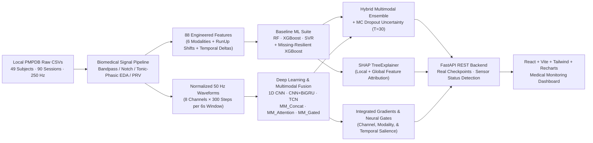

# System Architecture Documentation — Explainable Multimodal Pain-Intensity Estimation

## 1. End-to-End Architecture Overview

## 2. Modality-Specific Deep Learning Architecture (`MM_Gated`)

PMPDB provides **8 synchronized channels across 6 physiological/biomechanical modalities** (explicitly **no ECG** and **no EEG**):
1. **BVP Encoder** (`in_channels=2`: `Bvp`, `Bvp_RB`) → 3-stage 1D-CNN (kernels 7→5→3) + Dual Avg/Max Pooling → 32-D embedding
2. **EDA Encoder** (`in_channels=2`: `Eda_E4`, `Eda_RB`) → 3-stage 1D-CNN → 32-D embedding
3. **Resp Encoder** (`in_channels=1`: `Resp`) → 3-stage 1D-CNN → 32-D embedding
4. **Tmp Encoder** (`in_channels=1`: `Tmp`) → 3-stage 1D-CNN → 32-D embedding
5. **EMG Encoder** (`in_channels=1`: `Emg`) → 3-stage 1D-CNN → 32-D embedding
6. **Grip Encoder** (`in_channels=1`: `Grip`) → 3-stage 1D-CNN → 32-D embedding

### Context-Aware Gated Multimodal Fusion & Missing-Modality Masking
- Each modality embedding $\mathbf{e}_m \in \mathbb{R}^{32}$ is explicitly multiplied by its binary sensor availability mask $a_m \in \{0, 1\}$. Unavailable/flatlined modalities are **never fabricated**; their channel inputs and embeddings are strictly zeroed.
- A global available-sensor context vector $\mathbf{c} = \frac{\sum_m a_m \mathbf{e}_m}{\max(1, \sum_m a_m)}$ informs per-modality sigmoid gates:
  $$\mathbf{g}_m = \sigma\big(W_m [\mathbf{e}_m \,\|\, \mathbf{c}] + b_m\big), \qquad \tilde{\mathbf{e}}_m = a_m (\mathbf{e}_m \odot \mathbf{g}_m)$$
- Normalized modality importance weights $w_m$ are computed strictly over available modalities ($a_m = 1$), producing directly inspectable per-modality fusion weights.
- **Modality Dropout** ($p = 0.30$ dropping 1–2 random modalities per training sample) forces the gated fusion network to generalize gracefully when sensors disconnect.
- **Dual Output Head**:
  - Primary continuous regression head: bounded `[0, 100]` continuous pain score trained with **Huber Loss** ($\beta = 10.0$).
  - Auxiliary ordinal classification head: 3-class pain severity (`0` No/Low, `1` Moderate, `2` Severe) trained with **Cross-Entropy Loss**.
- **Epistemic Uncertainty (MC Dropout)**: At inference, Dropout layers remain active (`BatchNorm` frozen in eval mode) across $T = 30$ stochastic forward passes to compute predictive mean $\hat{\mu}$, epistemic standard deviation $\hat{\sigma}$, and OOF-calibrated 95% prediction intervals $[\hat{\mu} - 1.96 s\hat{\sigma}, \hat{\mu} + 1.96 s\hat{\sigma}]$.

## 3. Backend API Architecture (`backend/`)
- **Framework**: FastAPI + Uvicorn + Pydantic v2.
- **Singleton Model Service** (`backend/services/model_service.py`): Loads actual saved `.pt` (PyTorch) and `.joblib` (scikit-learn/XGBoost) checkpoints at startup and executes identical signal preprocessing as offline training.
- **Endpoints**:
  - `GET /api/health`, `GET /api/models/status`, `POST /api/models/reload`
  - `GET /api/dataset/summary`, `GET /api/dataset/participants`, `GET /api/dataset/recordings/{recording_id}`
  - `POST /api/preprocess`
  - `POST /api/predict/recording`, `POST /api/predict/timeline`, `POST /api/predict/custom`
  - `GET /api/explain/global`, `POST /api/explain/window`
  - `GET /api/evaluation/summary`
  - `GET /api/predictions/history`, `DELETE /api/predictions/history`
  - Static `/reports/figures/*` serving generated EDA and evaluation charts.

## 4. Frontend Dashboard Architecture (`frontend/`)
- **Stack**: React 18 + Vite 6 + Tailwind CSS 3 + Recharts + Lucide Icons, with Dark/Light theme switching.
- **Views**: Overview Dashboard, Signal Monitoring (with real 6-modality waveform playback & sensor dropout simulation), Pain Prediction (0–100 gauge, uncertainty intervals, continuous timeline, history log), Explainable AI (local & global SHAP, Integrated Gradients, temporal salience, neural gate weights), Dataset Explorer (all 49 participants & 90 recordings + EDA gallery), and Model Performance (all metrics, modality ablation, missing-modality stress tests, 49-participant MAE distribution).
- **Clear Mode Labeling**: Prominently distinguishes **Prerecorded Dataset Playback** from live clinical hardware acquisition and displays the academic research disclaimer.

